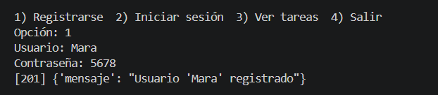
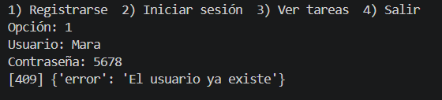
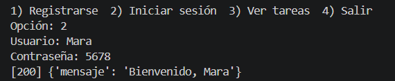
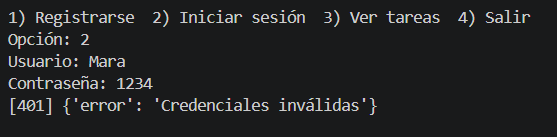
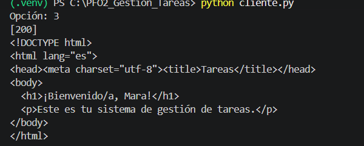
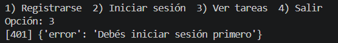
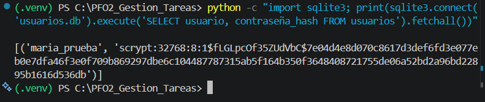

# PFO 2 – Sistema de Gestión de Tareas (API Flask + SQLite)

API REST con registro e inicio de sesión de usuarios (contraseñas hasheadas con
`werkzeug.security`), persistencia en SQLite y un cliente de consola.

## Requisitos
- Python 3.9+

## Instalación y ejecución
```bash
python -m venv .venv
source .venv/bin/activate        # Windows: .venv\Scripts\activate
pip install flask requests
python servidor.py               # API en http://127.0.0.1:5000
```
En Windows PowerShell, si bloquea la activación del entorno, ejecutar antes:
`Set-ExecutionPolicy -Scope Process -ExecutionPolicy RemoteSigned`

En otra terminal (con el entorno activado):
```bash
python cliente.py
```

## Endpoints
| Método | Ruta | Descripción |
|--------|------|-------------|
| POST | `/registro` | Body JSON `{"usuario": "...", "contraseña": "..."}`. Guarda el hash en SQLite. |
| POST | `/login` | Verifica credenciales e inicia sesión (cookie). |
| GET | `/tareas` | HTML de bienvenida (requiere haber iniciado sesión). |

## Pruebas con curl
```bash
curl -X POST http://127.0.0.1:5000/registro -H "Content-Type: application/json" \
     -d '{"usuario":"juana","contraseña":"1234"}'

curl -c cookies.txt -X POST http://127.0.0.1:5000/login -H "Content-Type: application/json" \
     -d '{"usuario":"juana","contraseña":"1234"}'

curl -b cookies.txt http://127.0.0.1:5000/tareas
```

## Capturas de pantalla

### Registro exitoso (201) y usuario existente (409)





### Login exitoso (200) y login fallido (401)





### GET /tareas con sesión iniciada y sin loguear





### Contraseña hasheada en la base de datos



## GitHub Pages
GitHub Pages solo hospeda sitios estáticos, así que **no puede ejecutar Flask**.
El archivo `index.html` de la raíz es la página de presentación del proyecto
(Settings → Pages → Branch `main` → carpeta `/ (root)`).
La API se ejecuta de forma local siguiendo las instrucciones de arriba.

## Respuestas conceptuales

**¿Por qué hashear contraseñas?**

Para no guardar nunca la contraseña real. Si la base de datos se filtra o alguien
con acceso la lee, solo ve hashes: funciones de un solo sentido que no se pueden
revertir directamente. Al iniciar sesión se hashea lo que ingresa el usuario y se
compara con el hash guardado. Además, librerías como Werkzeug agregan un *salt*
aleatorio a cada contraseña, de modo que dos usuarios con la misma clave tienen
hashes distintos y se dificultan los ataques con tablas precalculadas (rainbow
tables). Así se protege a los usuarios, que suelen reutilizar contraseñas en otros
servicios.

**Ventajas de SQLite en este proyecto**

- No requiere instalar ni administrar un servidor de base de datos: es un único archivo.
- Viene incluido en la biblioteca estándar de Python (`sqlite3`), sin dependencias extra.
- Es liviana y sencilla de configurar, ideal para un proyecto académico o un prototipo.
- Persistente y transaccional (ACID): los datos sobreviven al reinicio del servidor.
- Fácil de portar, respaldar y compartir (copiar el archivo `.db`).
